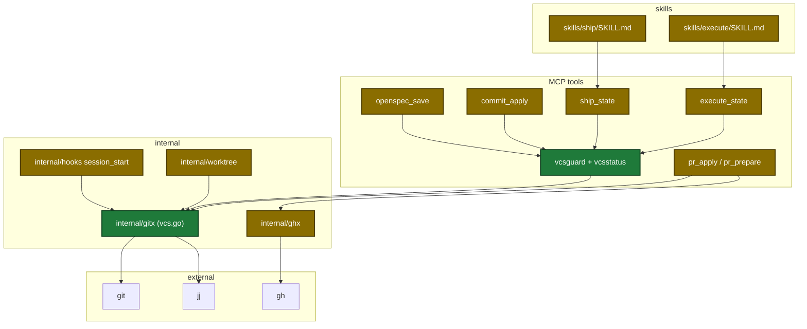
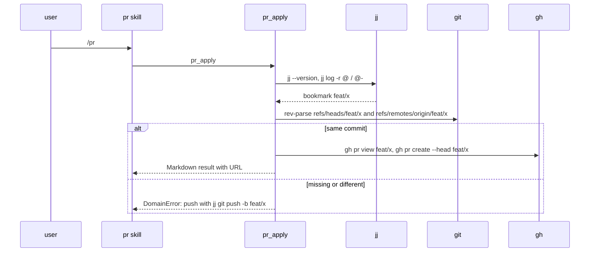

## Context

- Colocated jj keeps every read-only git call working; only branch lookup and writes break.
- One function, `gitx.CurrentBranch`, serves 25+ callers (`internal/gitx/gitx.go:26-35`).
- Execute and ship create branches and rebase in skill prose, not in tools.
- Execute treats a base-sync error as non-fatal and a wave-commit error as a wave failure (`plugins/sdlc/skills/execute/SKILL.md:225-228`, `:261-276`).
- Plan: `~/.claude/plans/2026-10-24-jujutsu-vcs-support-phase1.md`.

## Goals / Non-Goals

**Goals:**
- Detect git or jj mode once, in `internal/gitx`.
- Report the bookmark as the branch in jj mode.
- Stop every plugin write in jj mode with the jj command to run.
- Let `pr` open a PR for a pushed bookmark.
- Test with real jj; require it in CI.

**Non-Goals:**
- jj writes (`jj commit`, `jj bookmark create`, `jj git push`, `jj rebase`) — phase 2.
- New tool actions for prose stash, checkout, rebase — phase 2.
- `commit_prepare` listing files changed in `@` — phase 2.
- Non-colocated jj; jj `trunk()`; ship in jj mode.

## Decisions

| Decision | Chosen | Rejected alternatives | Reason |
|---|---|---|---|
| Where to detect | `internal/gitx/vcs.go` | new package | gitx wraps every shared git call |
| How to detect | walk up for `.git` and `.jj` | ask git | git fails first in a `.jj`-only repo |
| Version check | `jj --version` on each jj-mode call | cache | a cache can go stale; git mode never runs jj |
| Bookmark read | `jj log` with snapshot | `--ignore-working-copy` | a stale answer is worse than one jj operation |
| Ambiguity | error on 2+ bookmarks or a bookmark named `HEAD` | pick one | a guess can push the wrong bookmark |
| Write stop | one `jjWriteStop` for six tools | per-tool text | text and error class stay the same |
| Skill signal | `vcs` field on resolve-config; `vcs-mode` action on ship_state | session-start line | user chose a fresh tool field |
| Execute in jj | runs only with `commitWaves = false`; changes stay in `@` | let wave-commit fail | an early stop costs nothing |
| Ship in jj | stop at step 3 | run non-commit steps | every ship pipeline commits |
| gh lookup | new `PRForBranchName`; `PRCreateOpts.Head` | change `PRForBranch` | review and ship keep the old helper |

Architecture of the touched parts:

Main runtime flow for `pr_apply` in jj mode:

Persisted state: none added. The new field and action write no run state.

Data contracts:

| Field | Type | Encoding | Example |
|---|---|---|---|
| `vcs.mode` | string | plain text, enum git/jj/unknown | `jj` |
| `vcs.jjVersion` | string | plain text | `0.46.0` |
| `vcs.branch` | string | plain text | `feat/x` |
| `vcs.needsBookmark` | bool | JSON bool | `true` |
| `next` (resolve-config, vcs-mode) | string | plain text | `jj mode: stop. …` |

## Risks / Trade-offs

| Risk | Impact | Mitigation |
|---|---|---|
| Detector bug breaks every branch lookup | all users | git mode never runs jj; existing git tests must pass; `go test ./...` in Task 3 |
| jj output format changes | jj users | pinned minimum 0.46; template tested with real jj in CI |
| CI jj install fails silently | lost coverage | `SDLC_REQUIRE_JJ=1` turns a skip into a failure |
| `jj log` snapshot adds an operation | jj op log noise | accepted; same as any jj command |
| Ship unusable in jj in phase 1 | jj users | stop names the manual path; phase 2 adds jj commits |

## Migration Plan

- No config or state migration.
- Rollback: revert the release; git mode is unchanged.

## Open Questions

- None.
