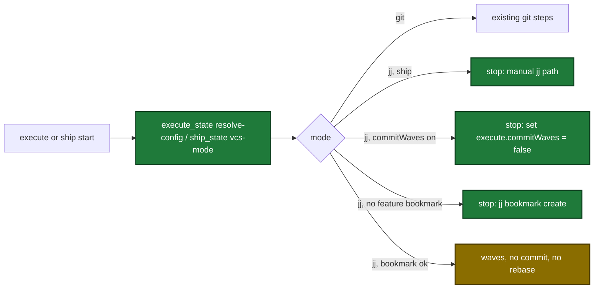

## Why

- Problem: in a colocated jj repository git has no current branch after any jj command, so the plugin reads the branch as `HEAD`, skips the feature-branch step, commits with no branch and pushes the wrong thing.
- Evidence: `gitx.CurrentBranch` (`internal/gitx/gitx.go:26-35`) runs `git branch --show-current` and returns `"HEAD"` on empty output; `pr_apply` fails with `checking upstream` on a detached HEAD (`internal/tools/pr.go:1131`).
- Why now: jj users want to run the sdlc skills; phase 1 (preplan Decision 6) makes the plugin safe under jj before phase 2 adds jj writes.

## What Changes

| Area | Before | After |
|---|---|---|
| VCS mode | git only | one detector reports git or jj; jj needs 0.46 or newer |
| Non-colocated jj repo | generic git error | error: "Run `jj git init --colocate` in the repository root." |
| Current branch in jj | `HEAD` | the one bookmark on `@`, else on `@-`, else `HEAD`; 2+ bookmarks is an error |
| Session start | Git line only | adds `VCS: git`, `VCS: jj <version> (colocated)` or `VCS: error — …` |
| Write tools in jj mode | write with git | stop with a DomainError that names the jj command |
| `pr_apply` in jj mode | pushes `HEAD` | never pushes; compares bookmark with `origin/<bookmark>` |
| `pr_prepare` in jj mode | `needsPush: true` always | `needsPush` from the bookmark check, with a warning and `next` |
| Execute in jj mode | branches and commits with git | stops unless `execute.commitWaves = false`; leaves changes in `@`; skips rebase and base sync |
| Ship in jj mode | runs | stops at its branch step and names the manual path |
| CI | no jj | installs pinned jj 0.46.0 and sets `SDLC_REQUIRE_JJ=1` |

Flow of the execute and ship start in jj mode after the change:

## Capabilities

### New Capabilities
- `vcs-mode`: git or jj detection, jj version check, non-colocated error, jj bookmark lookup, session-start VCS line, and the shared jj write stop.

### Modified Capabilities
- `tool-pr-apply`: the push requirement gains a jj-mode rule that never pushes.
- `tool-pr-prepare`: push status in jj mode.
- `tool-commit-apply`: stop in jj mode.
- `tool-execute-state`: wave-commit, base-sync and base-sync-resolve stops; `vcs` and `next` in resolve-config; jj manual-commit text.
- `tool-ship-state`: commit-check stop; read-only `vcs-mode` action.
- `tool-openspec-save`: stop in jj mode.
- `skill-execute`: jj gate in Step 0, rebase and base-sync skip, jj report line.
- `skill-ship`: jj stop at step 3.

## Impact

| Path | Kind | Change |
|---|---|---|
| `internal/gitx/vcs.go` | internal package | new detector |
| `internal/gitx/gitx.go` | internal package | bookmark lookup; `RefCommit` |
| `internal/worktree/worktree.go` | internal package | non-colocated error |
| `internal/hooks/session_start.go` | hook | VCS line |
| `internal/ghx/ghx.go` | internal package | named-branch PR lookup; `--head` |
| `internal/tools/vcsguard.go`, `vcsstatus.go` | MCP tool | shared stop and status builder |
| `internal/tools/commit.go`, `execute_state.go`, `ship_state.go`, `openspec_save.go`, `openspec.go`, `pr.go` | MCP tool | jj stops and fields |
| `plugins/sdlc/skills/execute/SKILL.md`, `plugins/sdlc/skills/ship/SKILL.md` | skill | jj routes |
| `.github/workflows/test.yml` | CI | jj install and require flag |
| `internal/jjtest/jjtest.go` | internal package | test helpers |
| `docs/getting-started.md`, `docs/plan-architecture.md`, `docs/smoke-test.md`, `docs/skills/*.md` | doc | jj notes |
