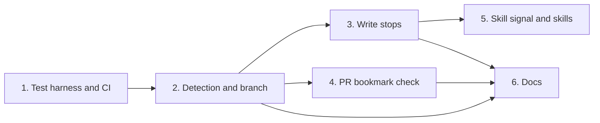

Group dependencies (groups with no path between them can run in parallel):

## 1. Test harness and CI

- [ ] 1.1 Add jj test helpers and pinned jj CI install in internal/jjtest/jjtest.go and .github/workflows/test.yml — verify: go test ./internal/jjtest/... <!-- ref:1-1-add-jj-test-helpers-and-pinned-jj-ci-a25c2c -->

## 2. Detection and branch

- [ ] 2.1 Add VCS mode detector and jj version check in internal/gitx/vcs.go — verify: go test ./internal/gitx/ -run 'TestDetectVCS|TestParseJJVersion|TestNonColocated' <!-- ref:2-1-add-vcs-mode-detector-and-jj-version-71748e -->
- [ ] 2.2 Read jj bookmarks in CurrentBranch in internal/gitx/gitx.go — verify: go test ./... <!-- ref:2-2-read-jj-bookmarks-in-currentbranch-i-7b059d -->
- [ ] 2.3 Return the non-colocated error from the root lookup in internal/worktree/worktree.go — verify: go test ./internal/worktree/ <!-- ref:2-3-return-the-non-colocated-error-from-8a459d -->
- [ ] 2.4 Add the VCS line to session start in internal/hooks/session_start.go — verify: go test ./internal/hooks/ <!-- ref:2-4-add-the-vcs-line-to-session-start-in-ce84a9 -->

## 3. Write stops

- [ ] 3.1 Add the shared jj write stop and the commit_apply stop in internal/tools/vcsguard.go and internal/tools/commit.go — verify: go test ./internal/tools/ -run 'TestJJWriteStop|TestCommitApply' <!-- ref:3-1-add-the-shared-jj-write-stop-and-the-0d803a -->
- [ ] 3.2 Add wave-commit, base-sync and base-sync-resolve stops in internal/tools/execute_state.go — verify: go test ./internal/tools/ -run 'TestExecuteState.*(WaveCommit|BaseSync)' <!-- ref:3-2-add-wave-commit-base-sync-and-base-s-0447e6 -->
- [ ] 3.3 Add commit-check and openspec_save stops in internal/tools/ship_state.go and internal/tools/openspec_save.go — verify: go test ./internal/tools/ -run 'TestShipState.*CommitCheck|TestOpenspecSave' <!-- ref:3-3-add-commit-check-and-openspec-save-s-6451c7 -->

## 4. PR bookmark check

- [ ] 4.1 Add RefCommit and named-branch gh helpers in internal/gitx/gitx.go and internal/ghx/ghx.go — verify: go test ./... <!-- ref:4-1-add-refcommit-and-named-branch-gh-he-d76bc9 -->
- [ ] 4.2 Add the jj bookmark check to pr_apply in internal/tools/pr.go — verify: go test ./internal/tools/ <!-- ref:4-2-add-the-jj-bookmark-check-to-pr-appl-36657c -->
- [ ] 4.3 Add jj push status to pr_prepare in internal/tools/pr.go — verify: go test ./internal/tools/ -run 'TestPrPrepare' <!-- ref:4-3-add-jj-push-status-to-pr-prepare-in-c7e7cf -->

## 5. Skill signal and skills

- [ ] 5.1 Add the vcs field to resolve-config and the vcs-mode action in internal/tools/vcsstatus.go — verify: go test ./... <!-- ref:5-1-add-the-vcs-field-to-resolve-config-f485e9 -->
- [ ] 5.2 Add jj routes to plugins/sdlc/skills/execute/SKILL.md and plugins/sdlc/skills/ship/SKILL.md — verify: go test ./internal/skillcheck/... <!-- ref:5-2-add-jj-routes-to-plugins-sdlc-skills-c5311c -->

## 6. Docs

- [ ] 6.1 Document jj prerequisites and the VCS line in docs/getting-started.md, docs/plan-architecture.md and docs/smoke-test.md — verify: grep -rn "VCS:" docs/ <!-- ref:6-1-document-jj-prerequisites-and-the-vc-51099c -->
- [ ] 6.2 Document the jj stops in docs/skills/pr.md, docs/skills/commit.md and docs/skills/openspec-save.md — verify: manual review <!-- ref:6-2-document-the-jj-stops-in-docs-skills-df4589 -->
